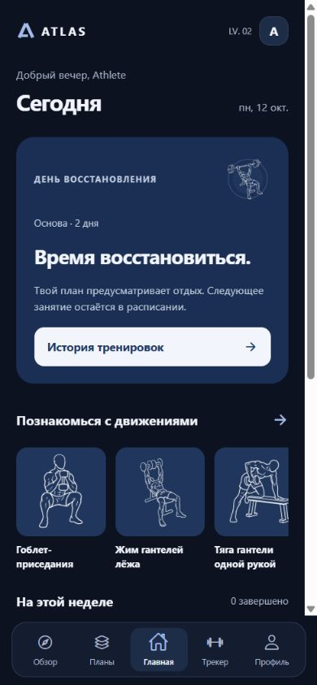
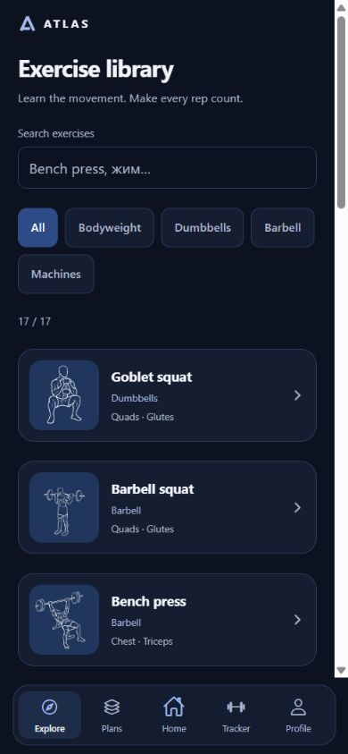
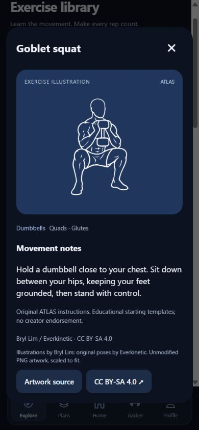
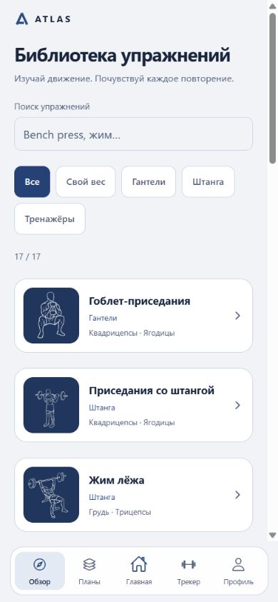
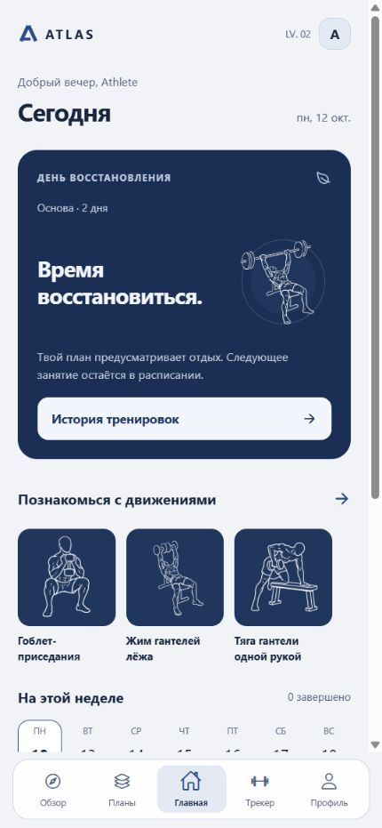

# ATLAS — тёмно-синий цвет и изображения упражнений

12 октября 2026. Изменения по запросу пользователя: заменить зелёный на тёмно-синий и добавить больше изображений в существующие элементы.

## Результат

- Общая палитра: тёмно-синие фон, карточки, кнопки и навигация. Светло-синие мелкие акценты сохраняют читаемость. Светлая тема использует холодный светлый фон и синие действия.
- На главной появились рисунок в основной карточке и горизонтальная лента упражнений. Если есть тренировка, лента использует её реальные упражнения; иначе показан ознакомительный набор. Нажатие открывает описание.
- В библиотеке вместо порядковых номеров показаны иллюстрации и группы мышц. В описании изображение увеличено.
- Миниатюры добавлены в заголовки упражнений трекера, выбор упражнений конструктора и предпросмотр программ. Большое описание открывается также из трекера.
- На ширине менее 420 px рисунок главной карточки переносится в верхнюю строку, оставляя заголовку всю ширину. Это устранило разрыв слова «восстановиться» на экране 320 px.

## Иллюстрации и авторство

Добавлены **16 статичных иллюстраций для 17 упражнений** (всего 368 546 байт). Все рисунки просмотрены; это отдельные позы, не видео или пошаговые демонстрации техники.

Источник: [Workout Guide / Bryl Lim](https://github.com/bryllim/workout-guide), исходные позы [Everkinetic](https://github.com/everkinetic/data), [CC BY-SA 4.0](https://github.com/bryllim/workout-guide/blob/main/LICENSE-ASSETS). Авторство доступно в приложении, подробные источники и контрольные суммы — в [реестре](licenses/exercise-media.json). PNG не изменены и хранятся внутри проекта; внешних запросов для показа картинок нет.

Изображение сплит-приседаний с гантелями исключено: в каталоге ATLAS это упражнение без отягощения. Для него оставлена явная заглушка с сообщением в описании. Фото и видео пока не добавлены.

## Проверки

- TypeScript: успешно; существующие тесты: **28/28**.
- Финальный экспорт Web, Android и iOS: успешно, включая локальные PNG. Это экспорт JavaScript/Hermes, не подписанные APK/IPA.
- Браузер: главная и библиотека, открытие/закрытие увеличенного изображения, фильтр «Свой вес», состояние без картинки и предпросмотр программы.
- Проверены размеры 320×740, 390×844 и 430×932, тёмная и светлая темы, английские и русские подписи. На главной при 320 px ширина документа равна ширине окна, горизонтального переполнения нет. Горизонтальная лента упражнений прокручивается внутри своего блока.
- В библиотеке загрузились все 16 изображений. SHA-256 всех локальных PNG совпадают с зафиксированными исходниками.
- После визуальной проверки восстановлены исходные пользовательские English + Dark. Тренировки, подходы и расписание при этой проверке не изменялись.

Активная тренировка и выбор упражнения конструктора не проходили отдельный браузерный сценарий в этом этапе; для их изменений выполнены проверка типов и экспорт. Нативные устройства, производительность и автономный повторный запуск пока не проверены.

## Скриншоты

Главная, тёмная тема, 390 px:

Библиотека, тёмная тема, 390 px:

Описание упражнения, 390 px:

Библиотека, светлая тема, 390 px:

Главная, светлая тема, 430 px:

Полный редизайн остальных экранов, фотографии, видео и дополнительные эффекты остаются отдельными следующими этапами.
