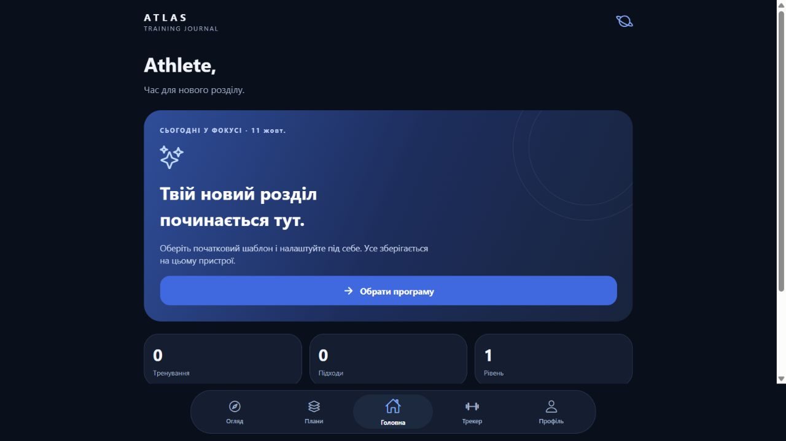

# ATLAS 0.1 — результаты проверки

Текущий визуальный этап от 12 октября: тёмно-синяя палитра и 16 локальных иллюстраций. Проверки и скриншоты: [NAVY_MEDIA_REVIEW_RU.md](NAVY_MEDIA_REVIEW_RU.md). TypeScript, 28/28 тестов и финальный экспорт Web/Android/iOS проходят.

Дополнение от 12 октября 2026: после конструктора и первого визуального этапа проходят **28/28 тестов**, TypeScript и экспорт всех платформ. Актуальный отчёт и новые скриншоты: [VISUAL_REVIEW_RU.md](VISUAL_REVIEW_RU.md). Данные ниже сохраняют результаты исходного этапа 0.1; текущий формат экспорта — 2 с поддержкой импорта формата 1.

Проверки выполнены 10–11 октября 2026 года на Windows. Это первый рабочий этап по обоим ТЗ; полный объём требований перечислен в [ROADMAP.md](ROADMAP.md).

## Автоматические проверки

| Проверка | Результат | Что подтверждает |
|---|---|---|
| TypeScript, `tsc --noEmit` | Успешно | Согласованность типов текущего проекта |
| Vitest | 16/16 | Логика расписания, транзакции, сохранение подходов, завершение, XP, валидация и восстановление копий на настоящей Node SQLite |
| Expo Doctor | 21/21 | Проверка конфигурации и совместимости зависимостей; TypeScript обновлён до поддерживаемой версии |
| `expo export --platform all` | Успешно | Web JS/WASM, Android и iOS Hermes bundles экспортированы в `dist` |
| Оригинальные тесты Daycounter | 43/43 | Изученные правила старого расписания и смены сплитов; исходный проект не изменялся |

Последний полный экспорт: web 3 MB, web worker 139 KB, Android Hermes 4.7 MB, iOS Hermes 4.5 MB. Это пакеты JavaScript для соответствующих платформ, **не APK/IPA и не проверка на телефоне**. Специальный lint не настроен и не запускался.

Набор из 16 тестов проверяет в том числе повторную инициализацию, личную копию программы, восстановление незавершённой сессии, немедленное сохранение подхода, отказ завершать неполную тренировку, защиту от повторного XP, неизменность истории, откат транзакции при ошибке начисления, повторное восстановление копии и отказ при неизвестном упражнении или повреждённых связях. Это проверка выбранных инвариантов, а не исчерпывающая проверка всех экранов и сочетаний настроек.

## Проверено в браузере

Локальный предпросмотр: `http://127.0.0.1:8085`. Сервер из `scripts/preview.mjs` добавляет COOP/COEP для SQLite WASM.

1. Первый запуск: украинский язык, тёмная тема, нулевая статистика, начальный каталог.
2. Активация Foundation с двумя тренировками в неделю; открытие назначенной тренировки.
3. Сохранение первого подхода: 10 повторений, 12.5 kg. После перезагрузки сохранились значения и прогресс 1/10.
4. Завершение десяти подходов: одна запись в истории, десять подходов, объём 125 kg и 100 XP; достигнут второй уровень и открыто первое достижение. Остальные девять подходов были тестовыми с нулевым весом.
5. Переключение на русский язык, светлую тему и Floating; настройки сохранились после перезагрузки. Выбор второго градиентного баннера попал в экспорт.
6. Визуальная проверка при ширине 390 px и высоте 844 px; проверенные экраны не имели горизонтального переполнения.
7. Экспорт реального JSON через интерфейс. Файл прочитан отдельно: `app: atlas`, версия 1, одна сессия, десять подходов, 100 XP и выбранные настройки.
8. Импорт подготовленной пустой тестовой копии через выбор файла и предварительный просмотр: показаны нулевые счётчики до замены. После подтверждения и перезагрузки профиль вернулся к украинскому языку, тёмной теме, первому уровню и нулевому XP.
9. Экспорт предыдущей копии после восстановления. Содержимое проверено отдельно: сохранены исходная тестовая сессия, десять подходов, одно XP-событие и настройки `ru/light/floating`.
10. Итоговый Home показывает чистое начальное состояние. В журнале текущей вкладки не зафиксированы ошибки или предупреждения. Итоговый скриншот сохранён ниже.

Использованы только созданные во время проверки тестовые записи. Реальные тренировочные данные пользователя не импортировались. Тестовая история убрана из основного журнала, но доступна в автоматически сохранённой предыдущей копии.

## Найденная проблема зависимости

В веб-канале `expo-sqlite@57.0.4` длина ответа записывалась в один байт вместо четырёх. Это вызывало обрезание JSON и сбой первой инициализации. Добавлено минимальное исправление в `scripts/patch-sqlite-web.mjs`, запускаемое через `postinstall`. Оно проверяет точную версию и исходный фрагмент, применяется повторно без изменений и не затрагивает нативные платформы. Версия зависимости закреплена; при обновлении исправление нужно пересмотреть.

Синхронный веб-канал также ограничивает размер ответа буфером 1 MiB. Перед работой с большой историей нужны асинхронные запросы с пагинацией. Этот предел не объявляется решённым данным исправлением.

## Границы проверки

- Android/iOS не запускались на устройстве или эмуляторе; разрешения файлов, клавиатура, safe areas, фоновые переходы, производительность и офлайн-перезапуск требуют отдельного этапа.
- Нет подписанной сборки, APK/IPA, публикации или установки PWA. Web здесь служит предпросмотром.
- Native file picker/share и CSV проверены кодом, но их полный пользовательский сценарий на телефоне не проверен.
- Не проверены все четыре стиля навигации во всех темах, многооконная работа, длительная история и все варианты accessibility.
- Фото, обрезка баннера, полный конструктор программ, импорт Daycounter и расширенная RPG остаются в плане работ.
- Проверка источников и условия использования контента описаны в [SOURCE_AUDIT_RU.md](SOURCE_AUDIT_RU.md). Четыре начальные программы и семнадцать упражнений не заменяют будущий целевой каталог 30–50 программ.
