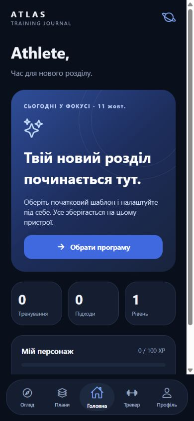
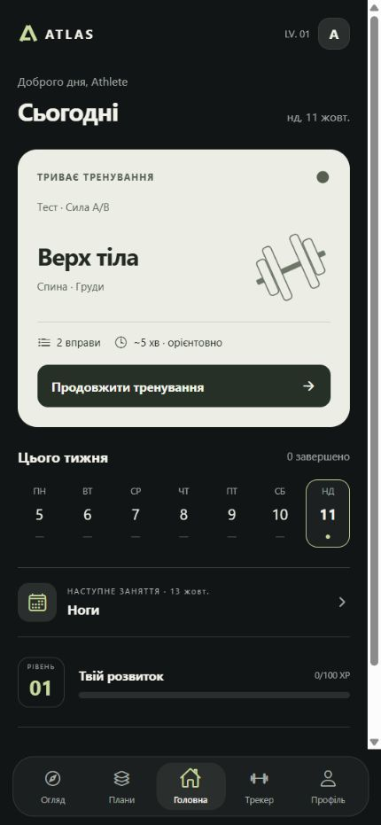
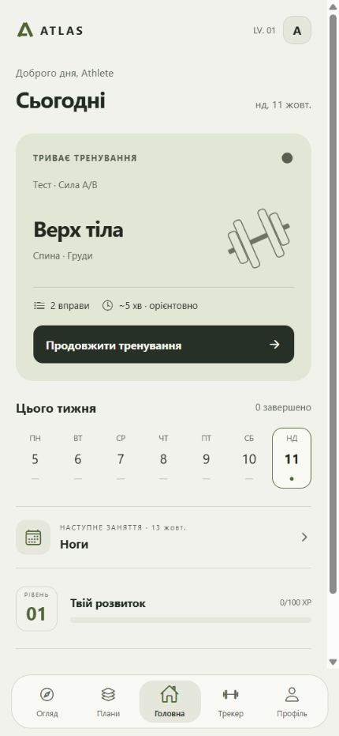

# ATLAS — первый этап визуального обновления

Реализовано и проверено 11–12 октября 2026 года. Объём этого этапа: **Home, нижняя навигация и общие элементы интерфейса**. По прямому указанию пользователя дальнейшая переработка отдельных экранов выполняется после одобрения этого результата.

## Что показал аудит

Сохранены исходные снимки пяти существующих экранов в `visual-review/*-before.jpg`. Повторялись крупные скруглённые карточки; большой заголовок и синий градиент занимали много места; одинаковые рамки придавали второстепенным данным слишком большой вес. Декоративная планета в шапке не выполняла функции. Библиотека упражнений оставалась текстовой, а профиль и трекер требовали собственной композиции.

| Часть | Изменено на этом этапе | Сохранено | Что остаётся |
|---|---|---|---|
| Home | Компактная шапка с профилем, временем суток и датой; одна главная карточка тренировки; мышцы, число упражнений и помеченная оценка времени; недельная полоса, следующее занятие, строка XP и журнал без одинаковых карточек | Запуск/продолжение, история, реальное расписание, Keep/Shift и отмена отдыха, XP | Расширенная аналитика и настоящие PR после появления соответствующей модели данных |
| Навигация | Плавно движущаяся подложка активной вкладки, сдержанная полупрозрачная поверхность, центральный Home, отклик на нажатие | Все пять маршрутов и четыре режима оформления | Нативное размытие и тактильный отклик |
| Общие элементы | Графитовая и светлая палитры, спокойный зелёный акцент, меньшие заголовки и радиусы, компактные кнопки, перенос длинных названий, новый знак ATLAS | Локализация, состояния disabled/selected, 44+ px области касания | Более сложные переходы модальных окон и жесты |
| Библиотека и детали упражнений | Получили общие цвета, шрифтовую иерархию и элементы управления | Поиск, фильтр оборудования, инструкции | Отдельный визуальный проход, фото/видео, фильтры мышц, расширенная страница упражнения — после одобрения |
| Трекер | Общая визуальная система; целевой вес и заметки из конструктора | Сохранение подходов, таймер, завершение, история, XP | Компактные строки подходов, медиа, редактирование текущей сессии — после одобрения |
| Программы | Общие элементы; рабочий конструктор с индивидуальными параметрами | Каталог, личные копии, явная активация версии, неизменяемая история | Отдельная композиция коллекций и обложки — после одобрения |
| Профиль | Общие элементы и палитра | Баннеры с прежними ID, имя/биография, XP, настройки, копии | Отдельная композиция профиля, фото/обрезка, расширенная RPG — после одобрения |

## Визуальные ориентиры

Изучены публичные страницы [Hevy](https://www.hevyapp.com/), [Strong](https://www.strong.app/), [Gentler Streak](https://gentlerstories.com/gentlerstreak) и [Linear](https://linear.app/features). Дополнительно просмотрен официальный [пример экрана регистрации подходов Hevy](https://www.hevyapp.com/wp-content/uploads/image-2-768x785.png): полезны плотность информации, различимые завершённые подходы и приоритет основного действия. У Strong — акцент на простоте журнала, у Gentler Streak — спокойное представление личного прогресса. Это ориентиры для собственных решений ATLAS; их изображения, оформление и брендовые элементы в приложение не переносились. Нативные приложения этих продуктов и их фактическая анимация не тестировались.

`ui-ux-pro-max` среди установленных skills не найден. В среде доступен штатный `skill-installer`, но проверенный пакет для дополнительной установки не был выбран. Новых зависимостей и сторонних исполняемых скриптов в этом этапе нет.

## Два визуальных прохода

Первый проход заменил иерархию Home, палитру и навигацию. После просмотра реального рендера уменьшены размер иллюстрации и заголовок пустого состояния, исправлено склонение количества упражнений, локализована подпись уровня. Второй проход проверен при 320×740, 390×844 и 430×932 в светлой и тёмной темах. На 320 px кнопка продолжения переносится на две строки и остаётся доступной; горизонтального переполнения Home не обнаружено, `scrollWidth` совпадает с шириной viewport.

### До

### После — тёмная тема

### После — светлая тема

Снимки с названием «Тест · Сила A/B» показывают реальное состояние отдельной тестовой базы на порту 8086. Это созданные при проверке записи, а не история пользователя и не подставленные счётчики. Первый снимок «до» показывает состояние без активной программы; сравнение иллюстрирует композицию, а не изменение пользовательской статистики. Основной предпросмотр остаётся на порту 8085, с отдельным браузерным хранилищем.

## Движение и медиа

- Кнопки и переключатели: уменьшение до 0.975 за 120 ms, сдержанный пружинный возврат; disabled-состояние меняет прозрачность за 200 ms.
- Навигация: подложка переходит к измеренной позиции вкладки за 200 ms.
- Home: при смене состояния тренировки — появление за 280 ms с перемещением на 6 пунктов. Нет постоянной декоративной анимации.
- Учитываются настройка уменьшения движения в приложении и системная настройка. Сам переключатель проверен в интерфейсе; системная настройка на реальном устройстве ещё не проверялась.
- Добавлены оригинальные графические элементы, нарисованные нативными View: знак ATLAS и иллюстрация гантели. Это оформление, не демонстрация техники.
- Фото и видео упражнений не добавлялись. Покрытие: **0/17 фотографий, 0/17 демонстраций**. Для каждой записи указан статус в [EXERCISE_MEDIA_COVERAGE.csv](EXERCISE_MEDIA_COVERAGE.csv). Следующий этап потребует проверенных лицензий и техники; чужие материалы и несвязанные стоковые фотографии не использовались.

## Проверка функциональности

В интерфейсе проверено создание плана с нуля: добавление двух тренировок, замена жима штанги на жим гантелей, изменение порядка упражнений, индивидуальные подходы/повторения/отдых/вес/заметка, цикл с восстановлением, предпросмотр, сохранение и активация. После перезагрузки порядок и параметры остались прежними. Отмена редактора не создаёт личную копию до сохранения — это также покрыто тестом репозитория.

Новый Home проверен в состояниях без программы, назначенной тренировки, восстановления, активной сессии и завершённой тренировки. Пройдено добавление отдыха со сдвигом, отмена отдыха, запуск и продолжение сессии. В трекер передались 8 повторений, 12.5 kg, 75 секунд отдыха и заметка; три тестовых подхода завершились с одним событием +100 XP. Навигация проверена в Balanced, Floating, Minimal и Dynamic. Смена темы и настройка reduced motion работают.

Экспорт JSON через интерфейс прочитан отдельной проверкой: формат 2, одна личная программа, одна сессия, три подхода; порядок упражнений, целевой вес 12.5 kg и заметка присутствуют. Импорт прежнего формата 1, версии программ и неприкосновенность активных/завершённых снимков покрыты автоматическими тестами. Приложение создаёт формат 2, чтобы старые версии не удаляли новые параметры молча.

| Проверка | Результат |
|---|---|
| TypeScript | Без ошибок |
| Vitest / настоящая Node SQLite | 28/28 |
| Экспорт web | Успешно, JS 3 MB + worker 139 KB |
| Экспорт Android / iOS | Успешно, Hermes 4.8 MB / 4.6 MB |
| Визуальный просмотр | Две темы, 320/390/430 px; скриншоты сохранены |

Зависимости не менялись; предыдущая проверка Expo Doctor 21/21 относится к базовому этапу и заново здесь не запускалась. Физический телефон/эмулятор, нативная клавиатура и модальные переходы, VoiceOver/TalkBack, системный reduced motion и реальная частота кадров не проверялись. Экспорт Hermes не является APK/IPA или подтверждением готовности к публикации.

## Граница следующего этапа

Результат предназначен для одобрения визуального направления. После одобрения можно последовательно перерабатывать библиотеку и страницу упражнения, затем трекер, программы и профиль. Полный визуальный overhaul, лицензированные демонстрации, haptics и жесты не объявляются завершёнными.
