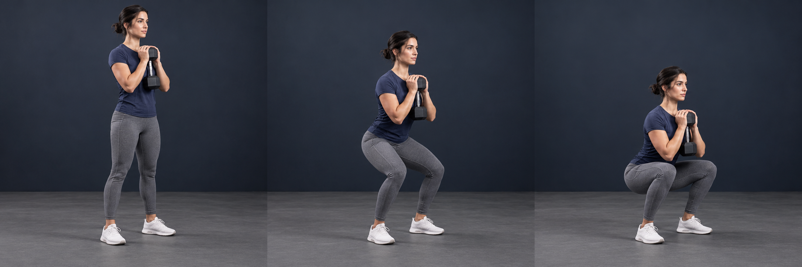
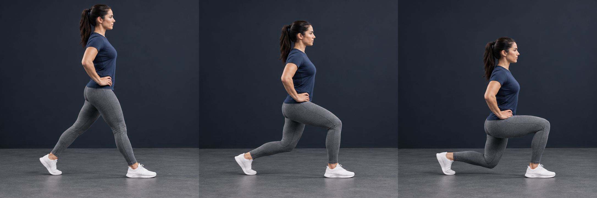
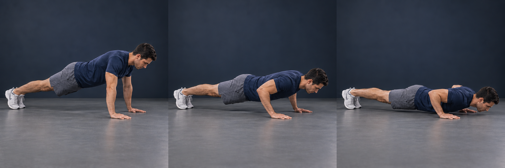

# ATLAS — generated exercise media review

Generated on 14 October 2026 with the built-in `image_gen` tool. No paid API fallback or extra dependencies were used. The images were copied unchanged from the tool output into this project. Source provenance: AI-generated imagery of fictional adult models; no source photographs or athlete identity references were supplied.

These are **three-pose storyboards, not videos**. The app may crop equal thirds and step through the frames. This is a reviewable prototype; it is not continuous motion, measured tempo, or certified exercise instruction. The user requested the opportunity to review generated assets. No expert technique approval has taken place.

## Files and review disposition

| Exercise | Project file | Actual dimensions | Disposition |
| --- | --- | --- | --- |
| Goblet squat | `assets/demos/goblet-squat-draft-v1.png` | 2172 × 724; 3 frames of 724 × 724 | Ready for clearly labelled draft preview and user review |
| Push-up | `assets/demos/pushup-review-v2.png` | 2172 × 724; 3 frames of 724 × 724 | Review only; excluded from ordinary animated technique preview |
| Bodyweight split squat | `assets/demos/split-squat-draft-v1.png` | 2172 × 724; 3 frames of 724 × 724 | Ready for clearly labelled draft preview and user review |

PNG dimensions and byte sizes were read from the saved files, not inferred from the prompt. The requested size was 3072 × 1024; the built-in tool actually returned 2172 × 724. No resizing, frame synthesis or cosmetic retouching was done locally.

### Visual inspection

- **Goblet squat:** consistent adult model, single dumbbell, full body in each frame, heels appear grounded, distinct start/middle/bottom. The bottom is deeper than the requested approximately parallel thigh position; there is slight foot/face drift. It needs user and technique review before final publication.
- **Push-up:** the first generation appeared to sag at the hips in the final frame. One targeted image-tool repair raised the pelvis and thighs. The final frame remains too close to the floor to establish clearance confidently, with forward head positioning. The corrected sheet is retained for comparison, but **must not be presented as approved technique or automatically enabled in exercise detail**. The rejected initial image remains at its original tool-output path, recorded in the manifest.
- **Split squat:** consistent model, no weights, same stationary split stance, front foot grounded, rear heel raised, knee apparently off the floor. Small pose/scale shifts remain; no expert has verified joint angles. This is a stationary bodyweight split squat, not the Bulgarian variation.

## Playback contract

Use square viewports, crop x = 0, 724, 1448, and show the complete 724 × 724 frame. Suggested review loop: `[0, 1, 2, 1]` at 800 ms per frame. This timing is for inspecting the images and must not be described as a prescribed exercise cadence. Respect reduced motion: initially show the first frame with manual frame selection and Play/Pause controls. Do not autoplay the push-up review-only asset.

Visible label in all supported languages:

- English: **AI draft · 3-frame preview**
- Russian: **AI-черновик · 3 кадра**
- Ukrainian: **AI-чернетка · 3 кадри**

Frame labels: Start / Lower / Bottom; Начало / Опускание / Нижняя точка; Початок / Опускання / Нижня точка. These are phase labels, not medically reviewed instructions.

## Review images

### Goblet squat

### Split squat

### Push-up — correction still required

## Reproduction and provenance

The full, exact generation prompts and the single push-up correction prompt are saved in [prompts.json](./prompts.json). [manifest.json](./manifest.json) records original tool-output paths, actual dimensions, review state, playback metadata and observed limitations. All original image-generator files were left in place. Generation used `transparent_background: false`. The push-up correction used the original PNG as `referenced_image_paths`; the other two assets and original push-up used brand-new generation with no reference images.

